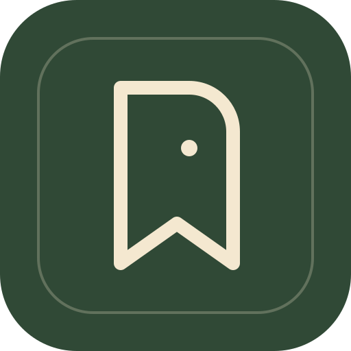
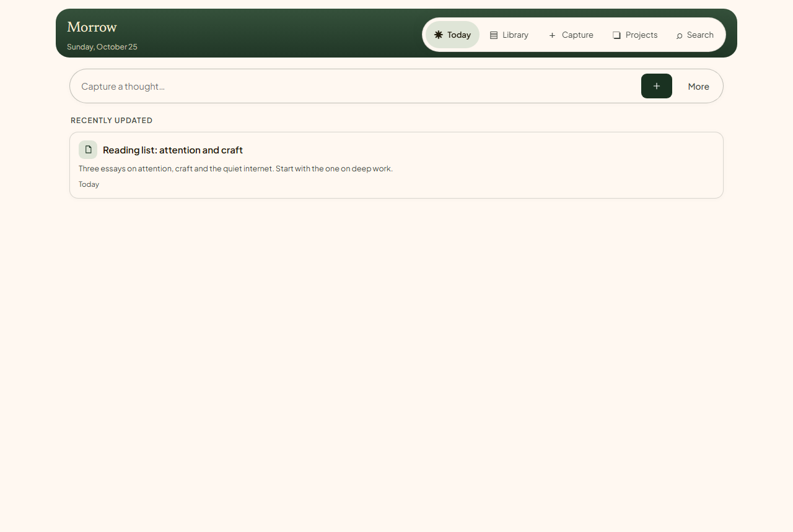
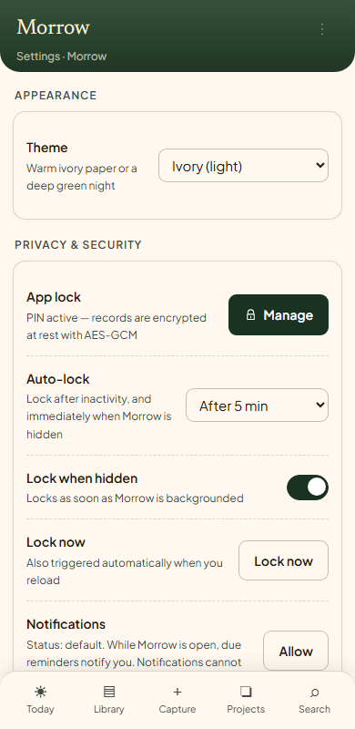
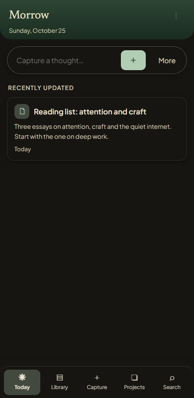

<p align="center">
  
</p>

<h1 align="center">Morrow</h1>

<p align="center">
  <strong>An offline-first personal memory vault.</strong><br>
  Capture notes, links, tasks and checklists. Organise them into projects. Attach files, set reminders,<br>
  and keep the things that matter on your own device.
</p>

<p align="center">
  <a href="https://github.com/Sahil-Psyche/Morrow-Releases/releases/latest/download/morrow-0.2.0.apk">
    
  </a>
  <a href="https://github.com/Sahil-Psyche/Morrow-Releases/releases/tag/v0.2.0">
    
  </a>
</p>

<p align="center">
  
  
  
  
</p>

---

> [!IMPORTANT]
> **Morrow 0.2.0 is the first public build.** It is a sideloaded Android APK, not a Play Store release. Please read the [known limitations](#known-limitations) before installing, and export a backup before relying on it.

## Download

**Morrow 0.2.0** · Android 7.0 (API 24) or newer · 3,500,965 bytes (~3.3 MB)

**[Download `morrow-0.2.0.apk`](https://github.com/Sahil-Psyche/Morrow-Releases/releases/latest/download/morrow-0.2.0.apk)** · [Release page](https://github.com/Sahil-Psyche/Morrow-Releases/releases/tag/v0.2.0)

SHA-256: `FA89937C4E44CF0CFA1B1E5559DC88368DCAF26EF56F4CCF49DD74C0545C97F8`

The published APK is the exact tested artifact — it has not been rebuilt or re-signed for this release.

## At a glance

| | |
| --- | --- |
| **Latest version** | 0.2.0 (versionCode 1) |
| **Package** | `com.morrow.vault` |
| **Platform** | Android 7.0+ (sideloaded APK) |
| **Storage** | On-device IndexedDB inside the app |
| **Account** | Not required |
| **Cloud sync** | None |
| **Analytics** | None |
| **Lock** | Optional PIN + recovery code |
| **Source code** | Maintained privately; this repository distributes builds only |

<p align="center">
  
</p>

<p align="center">
  
  &nbsp;&nbsp;&nbsp;
  
</p>

<p align="center"><sub>Screenshots use sample data. The Android app uses the same interface.</sub></p>

## What Morrow is for

Morrow is a quiet place for the things you want to keep: a thought before it disappears, a link worth returning to, a task with context, a checklist for a project, or a file that belongs with a note. It is designed for quick capture and calm retrieval, not for engagement metrics or a crowded dashboard.

It is also deliberately local. Your working vault lives in the app's storage on your device. There is no account to create, no sync service to trust, and no analytics pipeline watching what you write.

## Features

- **Today** — recent captures, due and overdue tasks, upcoming reminders and pinned items in one view.
- **Capture** — one screen for notes, records, tasks, checklists, links and attachments.
- **Library** — browse and filter by type, project or tag; pin, archive, trash and restore records, with a configurable trash-retention period.
- **Projects** — phases, status, summaries, linked records and completion statistics.
- **Search** — search titles, bodies, URLs, checklist items, attachment names and tags.
- **Attachments** — images, PDFs and other files stored with their records, up to 12 MB each.
- **Reminders** — one-off and recurring reminders, snooze and complete; overdue recurring items collapse to the latest missed occurrence.
- **Lock** — optional PIN and recovery-code vault, configurable auto-lock, lock when the app is hidden, and manual lock.
- **Backup** — export or import a single JSON file containing records, projects, reminders, attachments and vault metadata; merge into an existing vault or replace it.
- **Themes** — a warm ivory light theme and a deep green night theme.
- **Accessibility** — focus-trapped dialogs, restored focus, labelled controls, keyboard navigation and visible focus rings.
- **Offline shell** — the underlying app is an installable PWA with a service-worker cache and bundled fonts.
- **Android wrapper** — native share-sheet exports, hardware back-button handling, a stable WebView origin for updates, and Android auto-backup disabled.

## Privacy approach

Morrow's default is straightforward: **your working vault lives on your device.**

- **No account, no sync server, no analytics, no third-party tracking SDKs.** Morrow does not require a connection to open your vault, and it does not send your records to a Morrow server.
- **Encryption is optional and local.** If you enable the lock, record payloads and attachment bodies are encrypted at rest with **AES-256-GCM**. A random 256-bit data key is generated on the device and wrapped separately by your PIN and recovery code using **PBKDF2-SHA-256 (310,000 iterations)**.
- **Your PIN and recovery code are never stored.** The unwrapped data key exists only in memory while the vault is unlocked, as a non-extractable key; locking drops it.
- **Android auto-backup is disabled.** Use Morrow's own export in **Settings → Export backup** and keep the file somewhere private.
- **You can use Morrow without a lock.** In that mode, the vault is not encrypted. That is a deliberate choice, not a hidden detail.

### What is not encrypted

When the lock is enabled, record titles, bodies, URLs, checklist text and attachment contents are encrypted. The following metadata remains plaintext in local storage so Morrow can index and sort it:

- record kind, timestamps, tags, project association, pinned/archived state and due dates;
- project names, descriptions and status;
- reminder times.

Encrypting that metadata would require a different indexing design. It is a documented trade-off, not an oversight.

### What the lock is — and is not

The lock is a practical privacy screen for people using your device. It is enforced in the app rather than at the operating-system level, so someone with full device access and developer tools may be able to bypass it. Morrow has not undergone an independent third-party security audit.

For stronger protection, keep Android device encryption enabled, use a device screen lock, and maintain regular backups. No app can promise absolute security, and Morrow does not.

## Install on Android

1. Download [`morrow-0.2.0.apk`](https://github.com/Sahil-Psyche/Morrow-Releases/releases/latest/download/morrow-0.2.0.apk) on your Android device.
2. Open the downloaded file.
3. If prompted, allow your browser or file manager to install apps from this source.
4. Launch **Morrow**.
5. Create a lock with a PIN and recovery code, or choose **Use without a lock (unencrypted)**.
6. If you created a lock, store the recovery code somewhere safe. If you lose both the PIN and the recovery code, encrypted content cannot be recovered.

You can also install over USB with Android platform tools:

```bash
adb install -r morrow-0.2.0.apk
```

**Requirements:** Android 7.0 (API 24) or newer. The APK targets Android 16 (API 36).

### Updating

Install a newer Morrow APK over the existing app to keep your local data. Android requires every update to be signed with the same key; if the signing key ever changes, an uninstall and reinstall would be required, which erases local data unless you have exported a backup.

### Verify the download

```powershell
# Windows PowerShell
Get-FileHash .\morrow-0.2.0.apk -Algorithm SHA256
```

```bash
# macOS / Linux
shasum -a 256 morrow-0.2.0.apk
```

Expected SHA-256:

```text
FA89937C4E44CF0CFA1B1E5559DC88368DCAF26EF56F4CCF49DD74C0545C97F8
```

The APK is signed with APK Signature Scheme v2 using an RSA-4096, self-signed certificate. The certificate SHA-256 fingerprint is:

```text
b6b1e2fd2509351dec9b436494702e9760f609a06cb23181e29e1253ed93166b
```

You can inspect it with Android build-tools:

```bash
apksigner verify --print-certs morrow-0.2.0.apk
```

The fingerprint helps confirm that you have the same build; it does not establish a verified developer identity.

## V1 release notes — Morrow 0.2.0

Morrow's first public release is version **0.2.0**. It is the V1 public milestone: the first build intended for people outside the original development environment.

This release includes:

- the complete local vault: Today, Capture, Library, Projects and Search;
- notes, records, tasks, checklists, links and file attachments;
- project phases, statuses, summaries and linked records;
- one-off and recurring reminders with snooze and completion;
- optional PIN/recovery-code encryption, auto-lock and lock-on-hide;
- JSON backup export and import, with merge and replace modes;
- the installable PWA shell and the Android wrapper;
- light and night themes, keyboard-accessible dialogs and reduced visual noise throughout;
- release hardening around attachment downloads, encryption migration, cross-vault backup merges, checklist editing, PWA icons, Android back navigation and upgrade-in-place.

**Release verification:** the source passes 32 unit tests and a production build. The APK was verified as `com.morrow.vault` version 0.2.0 (versionCode 1), with a valid APK Signature Scheme v2 signature, and its SHA-256 matches the checksum above. The release candidate was also smoke-tested on an Android 15 emulator, including first-run onboarding, capture, persistence across relaunch, back navigation, backup export through the share sheet and upgrade-in-place.

## Known limitations

- **Android sideload only.** This is not a Play Store build. There is no iOS build or hosted PWA download in this repository; the Android APK is the supported build here.
- **Metadata is plaintext at rest.** See [What is not encrypted](#what-is-not-encrypted).
- **The lock is app-level.** It is not a full-disk or OS-level encryption boundary, and it has not been independently audited.
- **Local storage can be cleared.** Browser or OS storage eviction, resetting the app, or uninstalling can remove the vault. An exported backup is the durable copy; Android auto-backup is intentionally disabled.
- **Backups inherit the vault's state.** A backup from an encrypted vault is protected by that vault's PIN or recovery code. A backup from an unencrypted vault is readable, so store it privately.
- **Reminders are foreground-only.** Notifications fire while Morrow is open; the Android wrapper does not yet schedule OS notifications.
- **No sync or multi-device merge.** The Android app and the browser PWA are separate vaults; data does not move between them automatically.
- **Attachments are capped at 12 MB each.**
- **Unencrypted mode is not private against device access.** It is available for convenience and for people who prefer not to use a lock.
- **Future updates depend on the signing key.** Keep backups before updating; a signing-key change would require a reinstall.

## Roadmap

Morrow will continue to improve through future updates. The guiding constraint stays the same: a quiet, local-first vault with no account requirement, no advertising, no analytics and no forced cloud dependency.

| Direction | Status |
| --- | --- |
| Encrypted metadata and a private local index | Research |
| Native Android background reminders and notifications | Planned |
| More resilient backup, restore and export workflows | Planned |
| Biometric unlock on supported devices | Exploring |
| Accessibility, performance and large-vault polish | Ongoing |
| Android platform and dependency maintenance | Ongoing |

Roadmap items are intentions, not commitments or current features. Nothing in this table should be read as available in 0.2.0 unless it also appears in the feature list above.

## Built with

React 19, TypeScript, Vite, Capacitor, IndexedDB and the Web Crypto API. The interface uses Newsreader and Plus Jakarta Sans, bundled locally with the app.

## About this repository

This is Morrow's public download and release-notes repository. The application source code and signing keys are kept private. The APK is published here as a GitHub Release asset; the repository itself does not contain the source.

For a bug report, please include your Android version, device model, Morrow version and clear reproduction steps. Do not include vault contents, PINs or recovery codes in an issue.
